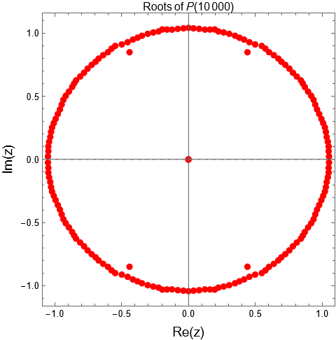
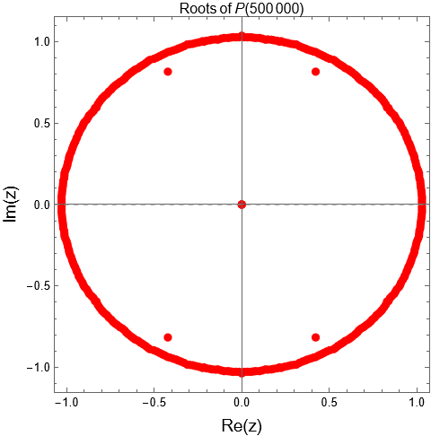

# For even $n \ge 8$, $\pi_2(n-5) = \pi(n-3) + \pi(n-5) + H(n) - \frac{n}{2}$


---------------------------------------------


## Goldbach's Conjecture and how to calculate $\pi(n)$ and $\pi_2(n)$

-----------------------------------------------------

Goldbach’s Conjecture (GC) is a well-known unproven mathematical statement. It asserts that every even integer,
 $n\geq 4$ can be expressed as the sum of two prime numbers. Assuming GC holds true, then for any even integer $n$, there exist prime 
 numbers $p$ and $q$ such that $n = p + q$. Let $p_n$ be the smallest prime number for which $q_n= n-p_n$ is also a prime. Define the following functions:
	$\pi(n)$ as the number of primes less than or equal to $n$, $\pi_2(n)$ as the number of twin primes less than or equal to $n$, $\delta_{6}(n)$ as the number of primes $p$ that $q-p \geq 6$, where $q$ is the next prime after $p$, $F_{n}(x)$ as the number of times that $p_k=x$ for every $k$, where $6 \leq k \leq n$, in other words, $F_{n}(x)$ counts how often a prime $x$ appears as the smallest prime in the Goldbach partition for even integers $k$ within the range $6 \leq k \leq n$. Then, the following relationships hold: 
 
 (i) $\pi(n) = F_n(3)+1$, (*) 
 
 (ii) $\pi_2(n) =F_n(3)-F_n(5)$ and (**)
 
 (iii) $\delta_6(n) = F_n(7)$
 
(*) On March 11th, 2026, I've finally found a reference published back in 1989 https://dms.umontreal.ca/~andrew/PDF/Goldbach1.pdf

(**) Although this formula did not appear in his 1989 paper, Professor Granville said in a personal communication (March 21st, 2026), “That is how we came up with our estimates, through these kinds of identities.” Therefore, Granville et al. should be credited for this identity as well.

-----------------------------------------------------

 Compile: g++ Goldbach_optimize.cc -o Goldbach_optimize -lz

 Run: ./Goldbach_optimize 1000000 result_1000000.gz

 Frequencies: python Goldbach_freq.py result_1000000.gz 1000000

 Output: $F_{1000000}(3)=78497$, $F_{1000000}(5)=70328$ and $F_{1000000}(7)=62185$
 
 Therefore, $\pi(1000000) = F_{1000000}(3)+1 = 78498$,   $\pi_2(1000000)=F_{1000000}(3) - F_{1000000}(5) = 8169$ and $\delta_6(1000000)=F_{1000000}(7)=62185$.
 
        
PS.: $F_n(5)$ is the number of primes $p \leq n$ such that $p+2$ is not a prime.

------------------------------------------------------

## Simple Example:

n = $p_n$ + $q_n$

4 = 2 + 2,

6 = 3 + 3,

8 = 3 + 5,

10 = 3 + 7,

12 = 5 + 7,

14 = 3 + 11,

16 = 3 + 13,

18 = 5 + 13,

20 = 3 + 17,

22 = 3 + 19,

24 = 5 + 19,

26 = 3 + 23,

28 = 5 + 23,

30 = 7 + 23,

32 = 3 + 29,

34 = 3 + 31,

36 = 5 + 31,

38 = 7 + 31,

40 = 3 + 37,

42 = 5 + 37,

44 = 3 + 41,

46 = 3 + 43,

48 = 5 + 43,

50 = 3 + 47


In this example, $F_{50}(3) = 14$ and $F_{50}(5) = 7$.
Therefore, $\pi(50) = F_{50}(3) + 1 = 15$ and $\pi_{2}(50) = F_{50}(3) - F_{50}(5) = 14 - 7 = 7$.

-----------

Maybe you should go with the polynomial approach instead. Take a look at: https://doi.org/10.13140/RG.2.2.35628.12162

## Prime Counting Goldbach Polynomials  $P_n(x)$


This paper introduces the polynomial $P_n(x) = \sum_{\substack{k=4 \\ k \text{ even}}}^{n} x^{p(k)}$, where $p(k)$ denotes the smallest prime such that $k - p(k)$ is also prime, reflecting the minimal prime in a Goldbach partition of the even integer $k$. We derive explicit formulas for the coefficients $c_m$ of $P_n(x) = \sum_m c_m x^m$, where the sum is over primes $m \geq 2$.

For $m = 2$, the coefficient is $c_2 = 1$ if $n \geq 4$, and 0 otherwise. For odd primes $m$, $c_m$ counts the number of primes $r$ in the range $3 \leq r \leq n - m$ such that no smaller prime $p < m$ yields a prime pair $r + (m - p)$. This is formalized via inclusion-exclusion: $c_m = \sum_{A \subseteq S} (-1)^{|A|} N_A(L)$, with $S = \mathbb{P} \cap (2, m)$, $L = n - m$, and $N_A(L)$ the count of odd primes $r \leq L$ where $r + (m - p)$ is prime for each $p \in A$.

Simplified expressions are provided for small primes: for $m = 3$, $c_3 = \pi(n - 3) - 1$; for $m = 5$, $c_5 = \pi(n - 5) - 2 - (\pi_2(n - 5) - 1)$, where $\pi_2(y)$ counts twin primes up to $y$; and for $m = 7$, $c_7 = \pi(n - 7) - 2 - (\pi_2(n - 7) + \pi_4(n - 7) - 1) + [3 \leq n - 7]$, with $\pi_4(y)$ counting cousin primes up to $y$.

To illustrate, consider $n = 30$. The polynomial is $P_{30}(x) = x^2 + 8x^3 + 4x^5 + x^7$. Using the formulas:  
- $c_2 = 1$ (since $n \geq 4$),  
- $c_3 = \pi(27) - 1 = 9 - 1 = 8$,  
- $c_5 = \pi(25) - 2 - (\pi_2(25) - 1) = 9 - 2 - (4 - 1) = 4$,  
- $c_7 = \pi(23) - 2 - (\pi_2(23) + \pi_4(23) - 1) + 1 = 9 - 2 - (4 + 4 - 1) + 1 = 1$,  
matching the explicit computation.

For a larger example, take $n = 50$. The polynomial is $P_{50}(x) = x^2 + 14x^3 + 7x^5 + 2x^7$, with coefficients verified as:  
- $c_3 = \pi(47) - 1 = 15 - 1 = 14$,  
- $c_5 = \pi(45) - 2 - (\pi_2(45) - 1) = 14 - 2 - (6 - 1) = 7$,  
- $c_7 = \pi(43) - 2 - (\pi_2(43) + \pi_4(43) - 1) + 1 = 14 - 2 - (6 + 6 - 1) + 1 = 2$.  

These results offer a novel framework for analyzing Goldbach partitions through generating functions, with potential implications for prime distribution studies.

Coefficients of Goldbach Polynomials: https://oeis.org/A391043

## How to Use the Goldbach Polynomial Generator Goldbach_polynomial.py

Run the script from the command line with an even integer $n \geq 4$:

```
python goldbach_polynomial.py <even_number_n>
```

### Examples

1. For \( n = 30 \):
   ```
   python goldbach_polynomial.py 30
   ```
   Output:
   ```
   x^2 + 8x^3 + 4x^5 + x^7
   ```

2. For \( n = 50 \):
   ```
   python goldbach_polynomial.py 50
   ```
   Output:
   ```
   x^2 + 14x^3 + 7x^5 + 2x^7
   ```

3. For \( n = 100 \):
   ```
   python goldbach_polynomial.py 100
   ```
   Output:
   ```
   x^2 + 24x^3 + 15x^5 + 8x^7 + x^{19}
   ```
### Roots of $P_n(x)$

$P_{10000}(x)= x^2 + 1228 x^3 + 1023 x^5 + 821 x^7 + 526 x^{11} + 382 x^{13} + 
 	241 x^{17} + 235 x^{19} + 126 x^{23} + 81 x^{29} + 107 x^{31} + 47 x^{37} + 
 	33 x^{41} + 32 x^{43} + 24 x^{47} + 24 x^{53} + 11 x^{59} + 25 x^{61} + 
 	10 x^{67} + 3 x^{71} + 5 x^{73} + 5 x^{79} + 2 x^{83} + x^{97} + x^{103} + x^{127} + 
 	2 x^{139} + x^{157} + x^{173}$

<p align="center">
  
</p>


Let $z_{n,k}$ be the k-th nonzero root of the polynomial $P_n(x)$. Then for almost all $k$, $z_{n,k}$ satisfy $|z_{n,k}| \to 1$ as $n \to \infty$ 

<p align="center">
  
</p>

Here is a version tailored to a **computational / numerical / data-oriented audience**, appropriate for GitHub users who care about algorithms, experiments, and diagnostics more than proofs:

---

### Goldbach polynomials

This approach translates additive questions about prime numbers into concrete, finite polynomials whose coefficients are derived from prime data, and studies the location of their complex zeros as numerical invariants. An analytic result shows that the distance between the point (z=1) and the nearest zero is tightly controlled by how much coefficient mass lies at small indices, making this “spectral gap” a sensitive statistic for detecting structural changes in the data. Under standard probabilistic models for primes (such as Hardy–Littlewood heuristics), the framework predicts a specific scaling law for this gap, which can be tested numerically. Extensive computations show that polynomials built from actual prime data follow the predicted scaling, while synthetic or perturbed models exhibit visibly different spectral behavior. The goal is not to resolve prime conjectures, but to provide a reproducible computational diagnostic for comparing prime models and validating heuristic assumptions through spectral data.

## Understanding the roots of the Goldbach polynomial

For even $n\ge8$, the minimal-prime Goldbach polynomial has the form

$$
P_n(x)=x^2+a x^3+b x^5+c x^7+\cdots.
$$

Its coefficients count minimal Goldbach partitions. They are nonnegative integers, with $a\ge2$. A **root** is a number $z$ for which $P_n(z)=0$. A polynomial of degree $D$ has $D$ complex roots when repeated roots are counted with their multiplicities.

### Start with the whole picture

Factor out $x^2$:

$$
P_n(x)=x^2Q_n(x),
\qquad Q_n(x)=1+ax+bx^3+cx^5+\cdots.
$$

This immediately explains several features of the roots:

- **Zero is a double root.** The factor $x^2$ gives two roots at the origin. Since $Q_n(0)=1$, there is no additional root there.
- **There are no positive real roots.** When $x>0$, every nonzero term of $P_n(x)$ is positive, so their sum cannot be zero.
- **Nonreal roots come in conjugate pairs.** Because the coefficients are real, if $u+iv$ is a root, then $u-iv$ is also a root. In a complex-plane plot, these pairs are mirror images across the horizontal axis.

A complex number $z=u+iv$ is plotted at the point $(u,v)$; its distance from the origin is its modulus $|z|$. Powers of a complex number can point in different directions and cancel, which allows nonreal roots even though the polynomial's coefficients are nonnegative.

The repository's numerical plot for $n=10000$ illustrates this picture:


Many nonreal roots in this example lie near the **unit circle**, the circle $|z|=1$. The conjugate symmetry is visible above and below the horizontal axis. This is a numerical observation for the plotted polynomial; it is not an assumption needed for the recovery argument below.

### The single negative root

Now consider the negative real axis. Write a negative root as $-r$, where $r>0$. The equation $Q_n(-r)=0$ becomes

$$
1=ar+br^3+cr^5+\cdots.
$$

The right-hand side increases strictly from zero to infinity, with derivative at least $a>0$. It therefore reaches $1$ exactly once. Thus **there is exactly one negative root**, and it is simple: it occurs only once.

Together, these facts account for every root: two at zero, one negative, and $D-3$ nonreal roots, counting multiplicities. For example, the degree-seven polynomial $P_{30}$ has a double root at zero, one negative root, and two conjugate pairs of nonreal roots.

The negative root also has a special location: **it is the nonzero root closest to the origin**. For any nonzero root $z$, the triangle inequality gives

$$
1=\left|az+bz^3+cz^5+\cdots\right|
\le a|z|+b|z|^3+c|z|^5+\cdots.
$$

Since the expression on the right increases with $|z|$ and equals $1$ at $|z|=r$, every nonzero root satisfies $|z|\ge r$. Equality requires all nonzero summands to point along the negative real axis; the term $az$ then forces $z=-r$. Every other nonzero root is therefore strictly farther away.

### Why this root determines all the coefficients

The **exact negative root encodes the whole polynomial**. We can read its coefficients much like the digits of a number: take the integer part, remove it, and rescale to reveal the next digit.

The essential ingredient is a coefficient bound. The coefficient of $x^2$ is exactly $1$, all other nonzero terms have odd prime exponents, and

$$
a=c_3(n)=\pi(n-3)-1\ge2,
\qquad 0\le c_p(n)\le a.
$$

Here $\pi(y)$ counts primes up to $y$. For any odd prime $p$, each even integer $k$ counted by $c_p(n)$ gives a distinct odd prime $k-p\le n-p\le n-3$. There are exactly $a$ odd primes up to $n-3$, which explains the bound.

### Read one coefficient at a time

From the root equation $1=ar+br^3+cr^5+\cdots$, we have $ar\le1$, hence $r\le1/a$. Dividing that equation by $r$ gives

$$
\frac1r=a+br^2+cr^4+\cdots.
$$

**The entire tail after $a$ is smaller than one:**

$$
0\le br^2+cr^4+\cdots
\le a(r^2+r^4+\cdots)
=\frac{ar^2}{1-r^2}
\le\frac{a}{a^2-1}
\le\frac23<1.
$$

Therefore, the integer part of $1/r$ is exactly the first coefficient:

$$
a=\left\lfloor\frac1r\right\rfloor.
$$

Here $\lfloor t\rfloor$ means the greatest integer less than or equal to $t$.

Now subtract $a$ and divide by $r^2$:

$$
\frac{1/r-a}{r^2}=b+cr^2+\cdots.
$$

The same bound shows that the tail after $b$ is smaller than one, so taking the integer part recovers $b$. Repeat to recover every later coefficient.

### The complete recovery rule

Let $d_j$ be the coefficient of $x^{2j+3}$, so $d_0=a$, $d_1=b$, $d_2=c$, and $d_3=0$ because $9$ is composite. Starting with $U_0=1/r$, use

$$
d_j=\lfloor U_j\rfloor,
\qquad
U_{j+1}=\frac{U_j-d_j}{r^2}.
$$

At each step:

1. Take the integer part to recover the next coefficient.
2. Subtract that coefficient.
3. Divide the remainder by $r^2$ to reveal the next one.

Include zero coefficients as you pass through the odd exponents $3,5,7,9,11,\ldots$. Stop when the **entire remainder is exactly zero**; a zero coefficient alone does not mean the polynomial has ended. The coefficient of $x^2$ is already known to be $1$, and all other even-power coefficients are zero.

Every step uses only $r$ and coefficients already recovered. Thus two polynomials satisfying these conditions cannot share the same negative root unless all their coefficients agree.

### Example: recovering $P_{30}(x)$

For the example

$$
P_{30}(x)=x^2+8x^3+4x^5+x^7,
$$

the exact negative root $-r$ produces these steps:

| Step | Value before taking the integer part | Recovered coefficient |
| --- | --- | --- |
| $U_0$ | $1/r=8+4r^2+r^4$ | $c_3=8$ |
| $U_1$ | $(U_0-8)/r^2=4+r^2$ | $c_5=4$ |
| $U_2$ | $(U_1-4)/r^2=1$ | $c_7=1$ |

The next remainder is zero, so the reconstruction is complete. These are exact identities; rounded decimal approximations are unnecessary for this example.

### Why “exact” matters

Later coefficients affect increasingly small details of the root. A rounded root can change an integer-part calculation, so numerical reconstruction needs certified error bounds and sufficient precision. Recovering the whole polynomial from approximate data also requires a degree bound; $\deg P_n\le n/2$ provides one.

The result establishes that the root encodes the polynomial. Finding that root accurately without already knowing the coefficients is a separate problem.

The proof also applies unconditionally if possible Goldbach exceptions are omitted from the defining sum.

## Maximal Prime Polynomial

By the way, the zeros of the polynomial $P_n(x) = \sum_{\substack{k=4 \\ k \text{ even}}}^{n} x^{k-p(k)}$, where $p(k)$ denotes the smallest prime such that $k - p(k)$ is also prime, reflecting the maximal prime in a Goldbach partition of the even integer $k$, have the same property. 

## Generalized Prime Polynomial

$G_n(x,y) = \sum_{\substack{k=4 \\ k \text{ even}}}^{n} x^{p(k)} y^{k-p(k)}$


## Weighted Goldbach Polynomial

This section defines the **weighted Goldbach polynomial**, a finite polynomial constructed from Goldbach representations of even integers, with logarithmic prime weights.

---


### Log-Weighted Goldbach Polynomial

The **log-weighted Goldbach polynomial** is defined by

$$P^{(1)}_n(x):=\sum_{p,prime}^n c_p(n) \log(p) x^p.$$

Here:
- each prime exponent $p$ is weighted by $\log( p )$,
- the weights introduce multiplicative prime structure into the polynomial.

---

### Remarks

- Both $P_n(x)$ and $P^{(1)}_n(x)$ are finite polynomials.
- The weighted version replaces purely additive prime data with logarithmically weighted data.
- The logarithmic weight matches the weight appearing in the logarithmic derivative of the Riemann zeta function.
- Let $z_{n,k}$ be the k-th root of the polynomial, then $\hat{z_{n,k}} = \frac{1}{1-z_{n,k}}$ has $\Re(\hat{z_{n,k}}) = \frac{1}{2}$

---


## Twin Prime and Goldbach Conjectures: A Quantitative Link


Assuming the **Goldbach conjecture**, for even $k \ge 4$, let $p(k)$ be the smallest prime such that $(k - p(k))$ is prime.
Define the polynomial

```math
P_n(x) = \sum_{\substack{4 \le k \le n \\ k \text{ even}}} x^{p(k)}
     = \sum_{\substack{m \text{ prime} \\ m \ge 2}} c_m(n) x^m,
```

where $c_m(n)$ counts the even $k \le n$ with $p(k) = m$.

The author's explicit formulas include:

```math
c_3(n) = \pi(n-3) - 1,
\qquad
c_5(n) = \pi(n-5) - 1 - \pi_2(n-5).
```

The sum of coefficients is $n/2 - 1$ for even $n$.
Let

```math
H(n) = \sum_{m \ge 7,\; m \text{ prime}} c_m(n).
```

---

### Theorem

For even $n \ge 8$,

```math
\pi_2(n-5)
= \pi(n-3) + \pi(n-5) + H(n) - \frac{n}{2}.
```

### Python Code
python VerifyFormula_H.py 10000

| n | pi_2(n-5) | pi(n-3) | pi(n-5) | H(n) | n/2 | right_side | formula_correct |
|---:|----------:|--------:|--------:|-----:|----:|-----------:|:----------------|
| 8 | 1 | 3 | 2 | 0 | 4 | 1 | Yes |
| 10 | 2 | 4 | 3 | 0 | 5 | 2 | Yes |
| 12 | 2 | 4 | 4 | 0 | 6 | 2 | Yes |
| 14 | 2 | 5 | 4 | 0 | 7 | 2 | Yes |
| 16 | 3 | 6 | 5 | 0 | 8 | 3 | Yes |
| 18 | 3 | 6 | 6 | 0 | 9 | 3 | Yes |
| 20 | 3 | 7 | 6 | 0 | 10 | 3 | Yes |
| 22 | 4 | 8 | 7 | 0 | 11 | 4 | Yes |
| 24 | 4 | 8 | 8 | 0 | 12 | 4 | Yes |
| 26 | 4 | 9 | 8 | 0 | 13 | 4 | Yes |
| 28 | 4 | 9 | 9 | 0 | 14 | 4 | Yes |
| 30 | 4 | 9 | 9 | 1 | 15 | 4 | Yes |
| 32 | 4 | 10 | 9 | 1 | 16 | 4 | Yes |
| 34 | 5 | 11 | 10 | 1 | 17 | 5 | Yes |
| 36 | 5 | 11 | 11 | 1 | 18 | 5 | Yes |
| 38 | 5 | 11 | 11 | 2 | 19 | 5 | Yes |
| 40 | 5 | 12 | 11 | 2 | 20 | 5 | Yes |
| 42 | 5 | 12 | 12 | 2 | 21 | 5 | Yes |
| 44 | 5 | 13 | 12 | 2 | 22 | 5 | Yes |
| 46 | 6 | 14 | 13 | 2 | 23 | 6 | Yes |
| 48 | 6 | 14 | 14 | 2 | 24 | 6 | Yes |
| 50 | 6 | 15 | 14 | 2 | 25 | 6 | Yes |
| 52 | 6 | 15 | 15 | 2 | 26 | 6 | Yes |
| 54 | 6 | 15 | 15 | 3 | 27 | 6 | Yes |
| . | . | . | . | . | . | . | . |
| . | . | . | . | . | . | . | . |
| . | . | . | . | . | . | . | . |
| 1795544234 | 5795581 | 88653001 | 88653001 | 726261696 | 897772117 | 5795581 | Yes |
| 1795544236 | 5795581 | 88653001 | 88653001 | 726261697 | 897772118 | 5795581 | Yes |
| 1795544238 | 5795581 | 88653001 | 88653001 | 726261698 | 897772119 | 5795581 | Yes |
| 1795544240 | 5795581 | 88653002 | 88653001 | 726261698 | 897772120 | 5795581 | Yes |
| 1795544242 | 5795582 | 88653003 | 88653002 | 726261698 | 897772121 | 5795582 | Yes |
| 1795544244 | 5795582 | 88653003 | 88653003 | 726261698 | 897772122 | 5795582 | Yes |
| 1795544246 | 5795582 | 88653003 | 88653003 | 726261699 | 897772123 | 5795582 | Yes |
| 1795544248 | 5795582 | 88653003 | 88653003 | 726261700 | 897772124 | 5795582 | Yes |
| 1795544250 | 5795582 | 88653003 | 88653003 | 726261701 | 897772125 | 5795582 | Yes |
| 1795544252 | 5795582 | 88653003 | 88653003 | 726261702 | 897772126 | 5795582 | Yes |

## Generalization (Conservation Law of Prime Numbers)

For integer $k \geq 1$ and even $n \geq 8 + 2k$,
		
$\pi_2(n-5) - \pi_2(n - 5 - 2k) = \bigl[ \pi(n-3) - \pi(n - 3 - 2k) \bigr] + \bigl[ \pi(n-5) - \pi(n - 5 - 2k) \bigr] + \bigl[H(n) - H(n - 2k)\bigr] - k.$	
		
or
		
## $k = \Delta_{\pi(n-3)} + \Delta_{\pi(n-5)} + \Delta_{H} - \Delta_{\pi_2(n-5)}$
		
		
where $\Delta_{\pi_2(n-5)}= \pi_2(n-5) - \pi_2(n - 5 - 2k)$ , $\Delta_{\pi(n-3)}=\pi(n-3) - \pi(n - 3 - 2k)$, $\Delta_{\pi(n-5)} = \pi(n-5) - \pi(n - 5 - 2k)$ and $\Delta_H =  H(n) - H(n - 2k)$.


Note that for $k=1$, this reduces to: $\pi_2(n-5) - \pi_2(n-7) = \pi(n-3) - \pi(n-7) + H(n) - H(n-2) - 1$

## Discrete Noether-style theorem

Let $t = n/2$ denote the discrete **arithmetic time** indexed by even integers. The Goldbach bookkeeping is homogeneous under the shift $n \mapsto n+2$ (equivalently, $t \mapsto t+1$ ): each step adds one new even number, while the coefficient-classification rules remain unchanged. Hence the linear background growth can be removed, and the corrected balance

$$
C(n)=\pi_2(n-5)-\pi(n-3)-\pi(n-5)-H(n)+\frac{n}{2}
$$

is invariant under discrete translations on the even lattice, that is,

$$
C(n)=C(n-2k)
$$

for all admissible $k \ge 1$. Equivalently,

$$
k=\Delta_{\pi(n-3)}+\Delta_{\pi(n-5)}+\Delta_H-\Delta_{\pi_2(n-5)}.
$$

In this sense, the conservation law of primes can be viewed as a **discrete Noether-style law**: translation invariance in arithmetic time yields an exactly conserved Goldbach balance.

## Conserved balance and one-step continuity law

For even $n \ge 8$, define the corrected balance

$$
C(n):=\pi_2(n-5)-\pi(n-3)-\pi(n-5)-H(n)+\frac{n}{2}.
$$

By the theorem

$$
\pi_2(n-5)=\pi(n-3)+\pi(n-5)+H(n)-\frac{n}{2},
$$

we have

$$
C(n)=0
$$

for every even $n \ge 8$.

Now define the one-step discrete difference on the even lattice by

$$
\Delta C(n):=C(n)-C(n-2).
$$

Then $C$ satisfies the one-step continuity law

$$
\Delta C(n)=0 \qquad (n\ge 10,\; n \text{ even}).
$$

Indeed,

$$
\begin{aligned}
C(n)-C(n-2)
&=\bigl[\pi_2(n-5)-\pi_2(n-7)\bigr] \\
&\quad-\bigl[\pi(n-3)-\pi(n-5)\bigr]
-\bigl[\pi(n-5)-\pi(n-7)\bigr] \\
&\quad-\bigl[H(n)-H(n-2)\bigr]+1.
\end{aligned}
$$

Using the $k=1$, conservation law

$$
\pi_2(n-5)-\pi_2(n-7)=
\bigl[\pi(n-3)-\pi(n-5)\bigr]
+
\bigl[\pi(n-5)-\pi(n-7)\bigr]
+
\bigl[H(n)-H(n-2)\bigr]-1,
$$

all terms cancel, giving

$$
C(n)-C(n-2)=0.
$$

Thus $C$ is conserved from one even step to the next. In arithmetic time $t=n/2$, if $C_t:=C(2t)$, then

$$
C_t-C_{t-1}=0.
$$

This is the discrete continuity law for the Goldbach balance.

## A cousin-prime identity

The coefficient formulas for the Goldbach polynomial suggest that the twin-prime identity is only the first member of a broader family. In particular, for even $n \ge 10$, the formula for $c_7(n)$ yields an identity for cousin primes.

Define

$$
H_{11}(n):=\sum_{\substack{m \ge 11\\ m \text{ prime}}} c_m(n),
$$

so that

$$
\frac{n}{2}-1 = c_2(n)+c_3(n)+c_5(n)+c_7(n)+H_{11}(n),
\qquad c_2(n)=1.
$$


Using

$$
c_3(n)=\pi(n-3)-1,
\qquad
c_5(n)=\pi(n-5)-1-\pi_2(n-5),
$$

and, for even $n \ge 10$,

$$
c_7(n)=\pi(n-7)-\pi_2(n-7)-\pi_4(n-7),
$$

we obtain

$$
\pi_4(n-7)=
\pi(n-3)+\pi(n-5)+\pi(n-7)+H_{11}(n)
-\pi_2(n-5)-\pi_2(n-7)-\frac{n}{2}.
$$

This gives a cousin-prime analogue of the twin-prime / Goldbach identity. It suggests that higher coefficient channels of the Goldbach polynomial may encode further prime-gap counting functions, leading to a broader family of conservation-type identities.

PS.:  g++ -O3 -march=native -DNDEBUG -std=c++20 Cousin_verifier.cpp -o Cousin_verifier

## A formula involving $\pi_6$

The next stage of the Goldbach coefficient expansion occurs at $m=11$. In this case, inclusion–exclusion over the smaller primes $3,5,7$ introduces the shifts $4,6,8$, so the coefficient $c_{11}(n)$ contains not only pair-counting functions such as $\pi_4$, $\pi_6$, and $\pi_8$, but also higher-order prime constellations.

For even $n \ge 14$, define

$$
H_{13}(n):=\sum_{\substack{m\ge 13\\ m\text{ prime}}} c_m(n).
$$

Then 

$$
c_{11}(n) =
\pi(n-11)-\pi_4(n-11)-\pi_6(n-11)-\pi_8(n-11)
+\pi_{4,6}(n-11)+\pi_{6,8}(n-11),
$$

where $\pi_{4,6}(x)$ counts primes $p\le x$ such that $p,p+4,p+6$ are all prime, and $\pi_{6,8}(x)$ counts primes $p\le x$ such that $p,p+6,p+8$ are all prime.

Using the coefficient-sum rule

$$
\frac n2-1 = c_2(n)+c_3(n)+c_5(n)+c_7(n)+c_{11}(n)+H_{13}(n),
\qquad c_2(n)=1,
$$

together with

$$
c_3(n)=\pi(n-3)-1,
$$

$$
c_5(n)=\pi(n-5)-1-\pi_2(n-5),
$$

and

$$
c_7(n)=\pi(n-7)-\pi_2(n-7)-\pi_4(n-7),
$$

we obtain

$$
\begin{aligned}
\pi_6(n-11)
&=
\pi(n-3)+\pi(n-5)+\pi(n-7)+\pi(n-11)+H_{13}(n) \\
&\quad-\pi_2(n-5)-\pi_2(n-7)-\pi_4(n-7)-\pi_4(n-11)-\pi_8(n-11) \\
&\quad+\pi_{4,6}(n-11)+\pi_{6,8}(n-11)-\frac n2.
\end{aligned}
$$

This shows that $\pi_6$ does appear naturally in the Goldbach-polynomial framework, but unlike the $\pi_4$ case, it is already coupled to larger-gap and prime-triplet terms.


------------
cite: https://doi.org/10.5281/zenodo.17913888, https://doi.org/10.13140/RG.2.2.22119.76963 , https://doi.org/10.13140/RG.2.2.15449.58721, https://doi.org/10.13140/RG.2.2.32286.60487

Watch the video of an explanation given by NotebookLM: https://youtu.be/DDWACYEdIhQ
